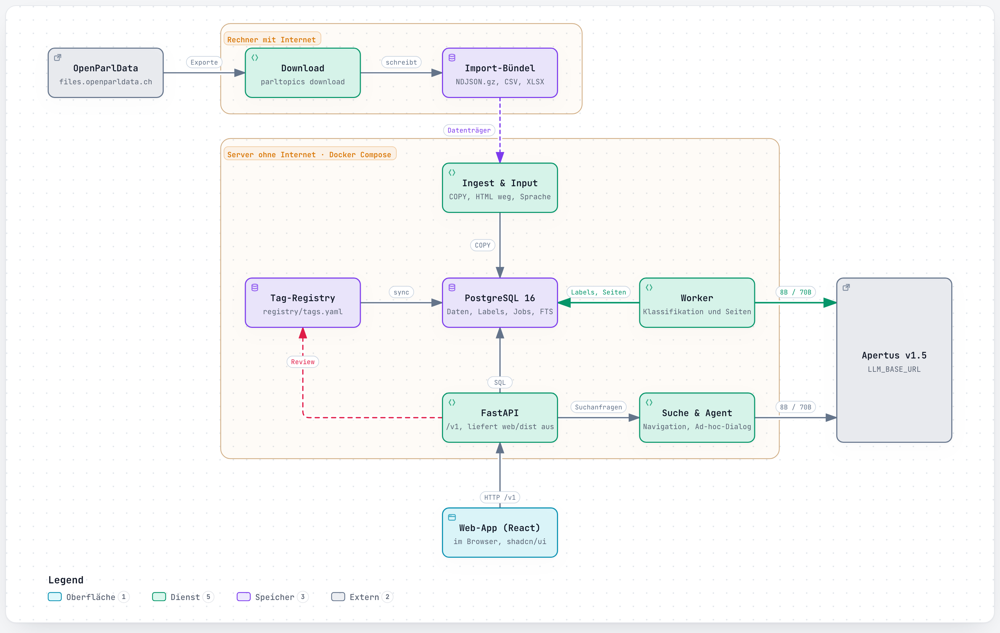
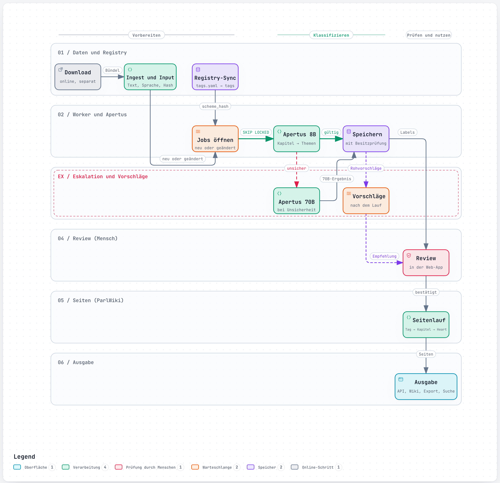
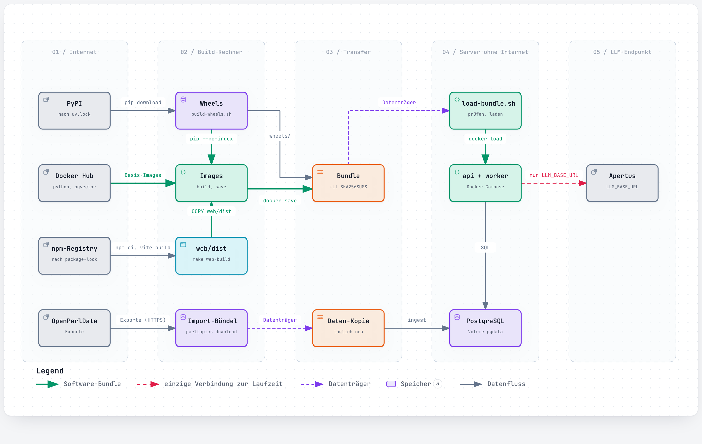

# Technical report — ParlTopics, Team Dreamers

Topic labels for every affair in OpenParlData, with Apertus v1.5, built to run without internet access.

- **Challenge:** OpenParlData: Topic classification for Swiss parliaments with Apertus
- **Event:** On-site Liebefeld, 18–19 October 2026
- **Team:** Dreamers — Eduan Roci, Lirim Zahiri, Mouad Medini
- **Repository:** <https://github.com/edu008/Dreamers4OpenParl>
- **Demo:** `link to video`

## 1. Summary

OpenParlData publishes 326'396 affairs from federal, cantonal and municipal parliaments in German, French, Italian and Romansh. These affairs share no topic scheme, so finding every affair on digitalisation still means guessing keywords in four languages.

ParlTopics is an open classification service built on Apertus v1.5. It labels each affair either with topics from the Année Politique Suisse scheme (APS: 165 topics in 22 chapters) or with ad-hoc topics that a user defines in one sentence, without retraining. Every label carries:

- a confidence value;
- a verbatim passage from the affair text, checked against the source;
- the versions of the model, prompt and registry that produced it.

A human can confirm, reject or replace any label in a review queue. Human decisions take precedence over later runs.

Headline results:

- **Quality:** on federal affairs, single-pass Apertus 70B reaches **84.6 %** agreement with the Curia Vista subject areas assigned by the Parliamentary Services (at least one hit, 473 affairs). The two-stage 8B → 70B pipeline reached 72.7 %, and our target was 75 %.
- **Throughput:** a measured 15-minute run labelled 2'678 affairs at all three parliament levels, without a single failed job (about 175 affairs per minute). At that rate, the whole corpus of 326'000 affairs takes about 31 hours on one shared endpoint.
- **Deployment:** the whole system runs air-gapped. Its only network connection at runtime is the Apertus endpoint.

## 2. Architecture



*Figure 1. Components and trust boundaries ([interactive version](docs/architecture/01-systemarchitektur.html)).*

ParlTopics has four parts:

- **Data layer:** a Python package (`src/parltopics/`) with a typer CLI and PostgreSQL 16, which holds data, labels, the job queue and the full-text index.
- **Workers:** deterministic, they label affairs.
- **Read-only agent:** answers search questions.
- **Web app and API:** a FastAPI service and a React web app for search, review and the ParlWiki.

The pipeline (Figure 2) has these steps:

1. **Download and ingest.** We use the bulk export from `files.openparldata.ch` (affairs, texts, docs, contributors), not API pagination. For each affair, `inputs` builds one cleaned classification text: title, submitted text, and the start of the first extracted document. HTML is removed, the language is detected, the length is capped, and the text gets an `input_hash`.
2. **Registry.** `registry/tags.yaml` is the single source of all tags, in SKOS form with DE/FR/IT/EN labels. Each sync freezes a `scheme_hash`, so every label can be traced back to the exact topic list it was chosen from.
3. **Job queue.** A run opens one job per affair and task in PostgreSQL. Workers claim jobs with `FOR UPDATE SKIP LOCKED`, send heartbeats, and write results in one transaction that starts with an ownership check. A killed worker loses nothing: its jobs time out and reopen. We used exactly this behaviour to stop the 15-minute run in Section 5.
4. **Classification.** Routine affairs (swearing-in, resignation, naturalisation, budget, accounts) get their topic from a title rule, without a model call. All other affairs get one Apertus call each (Section 3).
5. **Review, pages and export.** Model-proposed new tags wait in a review queue, and nothing is activated automatically. A page run summarises the labels bottom-up, from topic to chapter to area to the start page («Heart»), into the ParlWiki. The export writes `affair_topics.ndjson.gz`, a sidecar file with one line per affair that OpenParlData can join on its affair ID, plus the DVS list as CSV.



*Figure 2. Pipeline ([interactive version](docs/architecture/02-pipeline.html)). The dashed escalation lane only applies in the optional two-stage mode.*

Search combines three methods:

- cross-lingual full-text search that adds topic labels in DE/FR/IT to the query;
- a navigation search that walks the topic tree;
- an agent that uses Apertus tool calling. It has read-only tools only (`search_affairs`, `count_affairs`, `navigate_tree`, `get_affair`, `propose_adhoc_topic`), and it may only cite affair IDs that a tool returned.

### Target architecture (mandatory)

**ParlTopics targets b) Air-gapped**, which also covers a) and c).

- At runtime the application talks to one host only: the OpenAI-compatible Apertus endpoint in `LLM_BASE_URL`. The HTTP client refuses every other host.
- During the hack this endpoint was Keera (`https://gateway.keera.ch/api/v1`). In air-gapped operation, it is an Apertus server inside the same network (template: `deploy/docker-compose.llm.yml`).
- Code and images are identical in both cases.

| Phase | Where | External dependencies |
| --- | --- | --- |
| Build | machine with internet | PyPI (wheels pinned in `uv.lock`), npm registry (web app, pinned in `web/package-lock.json`, Node 22), Docker Hub (`python:3.12-slim`, `pgvector/pgvector:pg16`) |
| Data download | machine with internet | `files.openparldata.ch` |
| Transfer | removable media | bundle with images, wheels and checksums; data bundle |
| Runtime | server without internet | only `LLM_BASE_URL` |

The app image is built only from bundled wheels (`pip install --no-index`) and the prebuilt web app (`web/dist`). The web app loads no external scripts, fonts or stylesheets.

`make offline-test` runs the services in a Docker network without a route to the internet. It checks the migration, the registry, an LLM call (mock), the health endpoint and the web app, and it checks that outbound internet access fails. See [docs/AIRGAP.md](docs/AIRGAP.md) and Figure 3.



*Figure 3. Air-gapped deployment ([interactive version](docs/architecture/08-airgap-deployment.html)).*

## 3. Use of Apertus

- **Models:** Apertus v1.5 70B for classification (served by Keera as `apertus-v1-5-70b-thinking`; stored as `model_version` on every label), keywords, agent and summaries. Apertus v1.5 8B (`apertus-v1-5-8b`) for the optional two-stage mode.
- **How it is used:** inference (zero-shot classification with structured output) and agents / tool use. No fine-tuning.
- **Where it runs:** an OpenAI-compatible endpoint (`LLM_BASE_URL`). During the hack this was the Keera gateway, at temperature 0 with up to 12 parallel requests per worker. Any vLLM or TGI server serving the Hugging Face weights works the same way.

**Classification worker (`classify_single_v3`).** Each call handles exactly one affair:

- **Prompt layout.** The system message holds the rules and all 165 APS topics plus the active ad-hoc tags, grouped by chapter. The user message holds the affair text. Because the fixed part comes first, prefix caching can apply.
- **Schema-constrained output.** The answer is forced through a strict JSON schema (`response_format`). In that schema the tag field is an `enum` of the offered short names, so the model cannot invent a topic.
- **Evidence before the tag.** The model must quote the passage before naming the tag. The worker checks the quote against the source text (`word_similarity ≥ 0.9`). An unverified quote halves the confidence and is flagged.
- **Fit instead of a number.** The model states whether a topic is the core of the affair (`kern`, 0.9) or a side topic (`neben`, 0.6), because free-form confidence numbers followed the examples in the prompt.
- **Topics before institutions.** Subject topics come before institutions (Parliament, administration, parties). At most one institution is allowed, and only when the affair regulates the institution itself.
- **At most 3 labels.**

The model can also propose new tags. Proposals land in the review queue and are never activated automatically.

**Two-stage mode (`CLASSIFY_MODE=two_stage`).** 8B first picks chapters, then topics. The worker escalates to 70B on low confidence, invalid JSON, no topic, or a fixed 2 % calibration sample. We kept this mode for cheaper hardware, but dropped it as the default after the evaluation in Section 5.

**Ad-hoc topics (F8).** A user names a topic and describes it in a sentence, for example «Velowege». Apertus 70B then proposes up to 30 keywords per language (DE/FR/IT). Full-text search over these keywords selects candidates, a random sample is added to measure what the keywords miss, and the classifier labels both sets with the new tag offered next to the APS list. Nothing is retrained.

**Agent and ParlWiki.** The agent uses Apertus tool calling with at most 6 tool calls and a neutrality rule (`agent_system_v2`). Page summaries are written bottom-up by 70B, «factual, without judging political positions».

All prompts are versioned files in [`prompts/`](prompts/README.md). Their hash is stored on every label.

## 4. Data

- **OpenParlData bulk export** (`files.openparldata.ch/exports`): bodies, affairs, texts, docs and contributors. This is open government data from Swiss parliaments, and all of it is public. We load 326'396 affairs from all levels; 326'395 have a classification text. The export is downloaded into `data/import/` and is excluded from git.
- **Hack Apertus evaluation dataset** (`files.openparldata.ch/hackapertus`, snapshot 18.10.2026):
  - Curia Vista subject areas for 70'008 federal affairs;
  - the parliaments' own classifications for SG, TG, the city of Zug and ZH;
  - 3'433 PolitMonitor «Digitalisierung» affairs;
  - the DVS list of 30 digitalisation affairs;
  - the APS scheme.
- **Personal data:** affairs name their authors, who are public office holders. We use the first author's party only for the bias breakdown, and we store no other personal data. Reviewer names in the review queue are free text and are not exported.

## 5. Evaluation

**APS quality against Curia Vista (`parltopics eval --curia`).** Curia Vista assigns 28 subject areas to each federal affair. We map the 22 APS chapters to these areas (`registry/aps_descriptions.yaml`) and count an affair as a hit when at least one active label falls into one of its Curia areas.

| Setup (federal affairs since 2024) | n | At least one hit |
| --- | --- | --- |
| 8B two-stage with 70B escalation | 473 | 72.7 % |
| 70B single pass (`classify_single_v1`) | 473 | **84.6 %** |
| 70B single pass, 500 newest federal affairs | 499 | 87.5 % (top-1 72.3 %) |
| + title rules and topics/institutions split (`v2`) | 1'000 | top-1 82.3 %, top-2 91.0 % |
| Current prompt `v3`, federal affairs of the 15-minute run | 684 | 84.5 % (top-1 81.6 %) |
| All active labels after the 15-minute run | 1'037 | **86.2 %** (top-1 82.3 %) |

Separating topics from institutions cut labels that name only the actor ("Parliament", "Federal Council"):

| Level | Before | After |
| --- | --- | --- |
| Federal | 13 % | 2 % |
| Cantonal | 27 % | 8 % |
| Municipal | 26 % | 4 % |

**Throughput (15-minute run, 19.10.2026).** We opened three stratified runs: federal, the 26 cantonal parliaments, and 61 municipal parliaments. Three workers ran against them for exactly 15 minutes, each with up to 12 parallel 70B calls. We then stopped the workers and returned unfinished jobs to the queue.

| | Value |
| --- | --- |
| Affairs labelled in 15 min 21 s | 2'678 (federal 774, cantonal 1'438, municipal 466); 24 of them by title rule |
| Failed jobs | 0 (65 jobs were in flight when we stopped; they went back to the queue) |
| Throughput | 175 affairs/min, about 10'500 per hour, with 36 concurrent requests |
| Median time per affair | 9.8 s (one 70B call plus evidence check) |
| Extrapolated full run (326'000 affairs) | about 31 hours on the shared hackathon endpoint; more workers or a second endpoint shorten it, and daily updates are only a few hundred affairs |

**Bias check across languages and levels.** For the labels of the run, we compare per group the share of affairs with at least one label, the labels per affair, the share of verified evidence and the share of core-fit labels. `parltopics eval` produces the same breakdown by canton and by the party of the first author.

| Level | Language | Affairs | ≥ 1 label | Labels/affair | Quote verified | Core fit |
| --- | --- | --- | --- | --- | --- | --- |
| Federal | de | 684 | 93.0 % | 1.12 | 98.7 % | 94.1 % |
| Federal | fr | 81 | 96.3 % | 1.44 | 95.7 % | 88.2 % |
| Cantonal | de | 1'009 | 93.7 % | 1.25 | 95.9 % | 87.7 % |
| Cantonal | fr | 291 | 92.4 % | 1.20 | 96.3 % | 86.2 % |
| Cantonal | it | 138 | 89.1 % | 1.32 | 92.0 % | 80.8 % |
| Municipal | de | 313 | 94.6 % | 1.33 | 94.8 % | 86.0 % |
| Municipal | fr | 94 | 95.7 % | 1.17 | 96.7 % | 90.2 % |
| Municipal | it | 59 | 94.9 % | 1.44 | 93.5 % | 83.0 % |

Groups with at least 10 affairs; federal Italian affairs did not fall into the run. The rates are close across languages and levels. Cantonal Italian affairs (Ticino) are the weakest group on every measure, 4 to 7 points below the German ones. With 138 affairs this is a signal to watch, not yet a proven bias. The remaining affairs without a label are mostly procedural items that fit no APS topic.

**Agent (F21).** Twenty test questions, ten in German and ten in French, cover topic, counts, canton and period, overview, a single affair, a question with no hits, and an ad-hoc topic. In all runs, 20 of 20 answers cite only IDs returned by tools, none exceeds 6 tool calls, and `propose_adhoc_topic` never creates anything. After cross-lingual query expansion, all 3 cross-language questions find cited hits. Before the expansion, none did. By hand review, 13 answers are correct, 5 partly correct and 2 wrong ([tests/eval/agent_results.md](tests/eval/agent_results.md)).

**Ethics in the product.**

- **Explainability:** every label shows its confidence and the verified quote.
- **Bias:** the evaluation report splits by language, level, canton and party.
- **Neutrality:** the prompts forbid judging political positions.
- **Human in the loop:** every label is only a suggestion. A reviewer can confirm, reject, replace or undo it, and rejected tags stay rejected in later runs. Labels are never deleted; they only change status.

## 6. Limitations

- **Coverage.** Only part of the 326'000 affairs is labelled so far: 3'642 affairs with 4'843 active labels. The 15-minute run shows the rate, but it is not a full run.
- **Gold standard.** Curia Vista areas are coarser than APS topics and exist only for federal affairs, so the 84.6 % measures chapter-level agreement, not topic accuracy. The cantonal gold labels (SG, TG, Zug, ZH) use their own schemes, and we have not yet mapped them to APS.
- **DVS use case.** We have not yet reported recall on the 30 DVS affairs and the 3'433 PolitMonitor affairs. `parltopics eval --gold` computes it, but the digitalisation tag still has to be run over the candidates.
- **Romansh.** Romansh affairs are classified directly with the same prompt, but they are too few to evaluate separately.
- **Text depth.** For cantonal and municipal affairs, the classification text is the title plus the start of the first document, so long documents can be under-labelled.
- **Model variance.** At temperature 0 the endpoint still answers the same prompt differently in a few cases (agent question 16). Labels are reproducible only through the stored versions and hashes, not bit for bit.
- **API demo.** The prototype reads the bulk export, not the paginated API. The affair IDs are the same, so the export joins on OpenParlData directly.

## 7. Reproducibility

Requirements: uv, Docker with Compose v2, make and Node 22. Use any machine; the model runs behind `LLM_BASE_URL`. Set `LLM_NAME`, `LLM_NAME_LARGE`, `LLM_BASE_URL` and `LLM_API_KEY` in `.env` (see `.env.example`).

```bash
make setup && make db && make migrate && make test
uv run parltopics download --bundle data/import --bodies CHE
uv run parltopics ingest --bundle data/import
uv run parltopics registry sync
uv run parltopics inputs --body CHE --since 2024-01-01
uv run parltopics classify --task classify:aps --body CHE --since 2024-01-01 --limit 500
uv run parltopics eval --curia data/import/hackapertus/che_affairs_keywords.csv
uv run parltopics eval --gold data/gold --out data/eval/report.md
make web-build && make api        # http://127.0.0.1:8000, review at /admin/review
make offline-test                 # air-gap check
```

- **Versions:** each label stores its model, `prompt_version` (file name plus hash), `registry_version` and `input_hash`, so any number above can be traced to the run that produced it.
- **Parallelism:** `PARALLEL_70B=12` per worker.
- **Commit:** the 15-minute run used the code at `2f95882` (runs 36–38 in `classification_runs`).

## License

Code: Apache-2.0 (see `LICENSE`). This report: Creative Commons Attribution 4.0 (CC-BY-4.0). All Hack Apertus projects are open-sourced.

## References

- OpenParlData.ch, API and exports: <https://api.openparldata.ch/documentation>, <https://files.openparldata.ch>
- Année Politique Suisse, thematic scheme: <https://anneepolitique.swiss>
- Swiss AI Initiative, Apertus v1.5: <https://huggingface.co/swiss-ai/Apertus-v1.5-70B>
- Wan et al., TnT-LLM: Text Mining at Scale with Large Language Models, KDD 2024
- Archify (MIT), architecture diagrams: <https://github.com/tt-a1i/archify>
